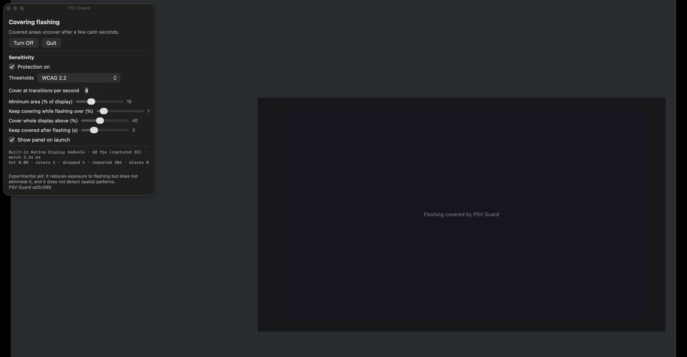
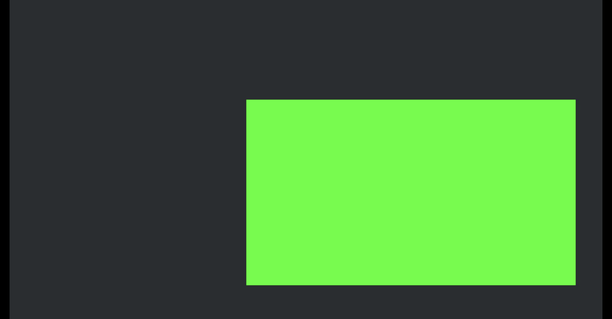
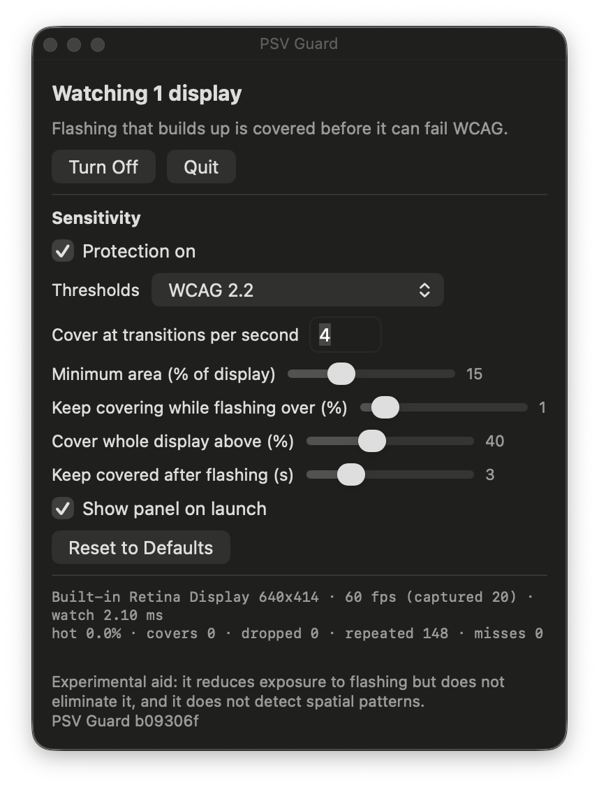

<p align="center">
  
</p>

<h1 align="center">PSV Guard</h1>

<p align="center">
  <b>A screen guard for photosensitive users; it watches your displays and covers flashing as it starts.</b>
</p>

<p align="center">
  PSV Guard lives in the menu bar, checks everything on screen with the <a href="https://github.com/brian-nunez/psv">psv</a> flash detector, and dims the parts that begin to flash.<br>
  <i>By Brian Nunez.</i>
</p>

<p align="center">
  
  
  
  
  <a href="https://github.com/brian-nunez/psvguard/actions/workflows/ci.yml"></a>
  <a href="https://github.com/brian-nunez/psvguard/releases/latest"></a>
</p>

<p align="center">
  <a href="https://github.com/brian-nunez/psvguard/releases/latest"></a>
</p>

<p align="center">
  <a href="https://github.com/brian-nunez/psvguard/releases/latest"><b>Download</b></a> ·
  <a href="https://github.com/brian-nunez/psv"><b>psv</b></a> ·
  <a href="#how-it-works">How it works</a> ·
  <a href="docs/adr/README.md">Decisions</a> ·
  <a href="AGENTS.md">AGENTS.md</a>
</p>

<br>

<p align="center">
  
  <br><sub><b>Covering a flashing video</b>: psv's failing example plays on the right; PSV Guard covers it while the rest of the screen stays visible.</sub>
</p>

> [!WARNING]
> **PSV Guard is an experimental aid.** It reduces exposure to flashing content but does not eliminate it, and it does not detect spatial patterns. Do not rely on it as your only protection.

<p align="center">
  <a href="#why-psv-guard">Why PSV Guard</a> ·
  <a href="#quick-start">Quick start</a> ·
  <a href="#screenshots">Screenshots</a> ·
  <a href="#how-it-works">How it works</a> ·
  <a href="#settings">Settings</a> ·
  <a href="#development">Development</a> ·
  <a href="#license">License</a>
</p>

## Why PSV Guard

- **Early.** It covers flashing as it builds up, before the detector has finished deciding that the content fails: about a third of a second after full-screen flashing starts, and before psv's first failing frame on its failing examples.
- **Targeted.** Only the flashing part of the screen is dimmed, so the rest stays usable. When most of a display flashes, the whole display is covered. Scrolling, typing and ordinary video stay uncovered.
- **Calm.** Covers fade in quickly, fade out slowly and stay in place through the gaps between flashes, so the guard never becomes a flashing source itself.
- **Out of the way.** It runs from the menu bar, with no Dock icon, and its covers never take focus or block clicks.
- **Grounded in a real detector.** Detection comes from [psv](https://github.com/brian-nunez/psv), which follows the WCAG 2.2 flash thresholds.

## Quick start

Download `PSV-Guard-macos.zip` from the [latest release](https://github.com/brian-nunez/psvguard/releases/latest), unzip it and move **PSV Guard.app** to Applications. It runs on macOS 14 or later, on Apple silicon and Intel Macs. Each release also has `SHA256SUMS`:

```sh
curl -fLO https://github.com/brian-nunez/psvguard/releases/latest/download/PSV-Guard-macos.zip
curl -fLO https://github.com/brian-nunez/psvguard/releases/latest/download/SHA256SUMS
shasum -a 256 -c SHA256SUMS
```

The app is signed ad hoc, not notarised, so macOS blocks it the first time you open it. Choose **Done**, then open System Settings → Privacy & Security, choose **Open Anyway** next to PSV Guard, and confirm. macOS remembers the choice. Alternatively, clear the download quarantine before opening it: `xattr -dr com.apple.quarantine "/Applications/PSV Guard.app"`.

To build it from source instead:

```sh
make app                       # build and sign dist/PSV Guard.app
open "dist/PSV Guard.app"      # start it; it appears in the menu bar
```

On first launch, macOS asks for **Screen Recording** permission. Grant it in System Settings, then quit and reopen PSV Guard. Click the shield in the menu bar for the panel; right-click it for the on/off toggle and Quit.

The menu bar icon shows what PSV Guard is doing:

| Icon | Meaning |
| ---- | ------- |
| Shield | Watching every display. |
| Orange crossed-out eye | Covering flashing. |
| Shield with an exclamation mark | Screen Recording permission is needed. |
| Crossed-out shield | Protection is off, or the Mac is asleep. |
| Orange warning triangle | Something needs attention; the panel says what. |

If the permission is lost after an update or a rebuild, reset it and grant it again:

```sh
tccutil reset ScreenCapture com.briannunez.psvguard
```

PSV Guard runs on macOS 14 or later. Building needs Go 1.25 or later, the Xcode Command Line Tools and FFmpeg (used by the tests).

### Linux (Wayland)

PSV Guard runs in Wayland sessions; X11 sessions are not supported. On Omarchy (Hyprland) and other compositors with `wlr-layer-shell` it covers flashing as on macOS. On GNOME, including Ubuntu's default desktop, apps cannot draw over other apps, so PSV Guard warns instead: its status turns to a warning and a notification asks you to look away.

Build it from source. On Omarchy or Arch:

```sh
sudo pacman -S --needed go pkgconf gtk3 gtk-layer-shell libayatana-appindicator pipewire
```

On Ubuntu:

```sh
sudo apt install golang-go pkg-config libgtk-3-dev libgtk-layer-shell-dev libayatana-appindicator3-dev libpipewire-0.3-dev
```

Then build and install it under `~/.local` (the binary, a desktop entry and the icon), and start it:

```sh
make install-linux
psvguard
```

On first launch the system asks which screen to share. Choose a display and tick the option to remember the choice, so later launches skip the dialog. Hyprland's dialog shares one monitor at a time, so with several monitors it opens once more for each display not yet shared. The item in the bar's tray opens a menu with the status, the on/off toggle, the panel and Quit. **Share Screen…** in the panel asks again from a fresh choice.

Screen capture on Linux includes PSV Guard's own covers, so content under a cover is not analysed: a cover over content that keeps flashing lifts after the calm time (3 seconds by default) and returns as soon as the flashing is seen again.

## Screenshots

| Without PSV Guard | With PSV Guard |
| ----------------- | -------------- |
|  |  |

<p align="center">
  
  <br><sub><b>The panel</b>: status, sensitivity settings, live stats per display, and the experimental-aid notice.</sub>
</p>

## How it works

1. PSV Guard captures each display, scaled to about 640 pixels wide, and analyses it 60 times a second.
2. Every display gets its own [psv](https://github.com/brian-nunez/psv) analyser, which reports, in each frame, where pixels are building up transitions.
3. When flashing builds up over enough of the screen, and fills the areas it covers the way flashing does rather than the way scrolling text does, PSV Guard covers those areas with dark, near-opaque panels.
4. Once an area has been calm for three seconds, its cover fades away. Any failure psv later decides that was not covered is covered at once and counted.

PSV Guard's own covers are kept out of the capture, so they never trigger more covering. The details, including the measured timings, are in [docs/architecture.md](docs/architecture.md).

## Settings

Settings are in the panel and saved in `~/Library/Application Support/psvguard/settings.json`. Every setting is also a command-line flag of the same name, which overrides the saved value for that run. **Reset to Defaults** in the panel restores every setting below except `enabled`, so protection stays on or off as it was.

| Setting | Default | Effect |
| ------- | ------- | ------ |
| `enabled` | `true` | Watch the screen and cover flashing. |
| `preset` | `wcag22` | psv thresholds: `wcag22`, `trace24` or `broadcast`. |
| `hot-peak` | `4` | Transitions within a second at which an area counts as building up flashing (WCAG fails above 6). |
| `min-hot-area` | `15` | Share of the display, in percent, that must build up flashing before covering starts. |
| `flashing-area` | `1` | Keep covers up while this share of the display, in percent, already flashes. |
| `full-area` | `40` | Cover the whole display once this share, in percent, is covered. |
| `calm` | `3` | Seconds an area stays covered after it last built up flashing. |
| `fps` | `60` | Frames analysed per second for each display. Flag or settings file only; applies on restart. |
| `capture-width` | `640` | Width, in pixels, each display is scaled to for analysis. Flag or settings file only; applies on restart. |
| `panel` | `true` | Show the panel when PSV Guard starts. |

Other flags: `--verbose` logs decisions and per-display stats (frame rate, time per frame, hot area, covers, misses) to stderr, `--trace-bridge` logs every bridge event and command, and `--version` prints the version.

## Platforms

| Platform | Status |
| -------- | ------ |
| **macOS** 14+ | Supported |
| **Linux, Wayland** with `wlr-layer-shell` (Omarchy / Hyprland, KDE, Sway) | Supported; built from source |
| **Linux, GNOME on Wayland** (Ubuntu) | Warnings only: GNOME lets no app draw over others |
| Linux, X11 | Not supported ([ADR-0008](docs/adr/0008-add-a-wayland-bus-for-linux.md)) |

Everything except the native capture and drawing layer is plain Go, so adding a platform means adding that one layer.

## Development

```sh
make test                      # race tests, psv's example videos, synthetic clips, Linux and no-cgo builds
make test-short                # the same without the video tests
make smoke                     # capture smoke test (macOS: Screen Recording permission; Linux: a Wayland session)
make lint                      # golangci-lint, configured in .golangci.yml
make fmt-check                 # fail if formatting would change anything
make run                       # build the app and run it with --verbose in the terminal
make release                   # build the universal app, zip it and write SHA256SUMS into dist/
make dev-up DESKTOP=omarchy    # Linux: a Hyprland desktop in Docker, at http://localhost:6081/ through noVNC
```

Linux work is built and checked inside the Docker desktops in [`dev/linux`](dev/linux), so nothing runs in your own session. `make dev-shell` opens a shell there; inside, `psvguard-session run <command>` runs a command in the desktop's Wayland session, for example `psvguard-session run ./build/psvguard --verbose` or `psvguard-session run make smoke`. Hyprland needs the host's GPU; on hosts with NVIDIA's proprietary driver the image installs the matching userspace driver.

### Releases

Releases are made by GitHub Actions, not from a local machine. The [CI workflow](.github/workflows/ci.yml) checks formatting, vet, lint and `make test` on macOS, builds the release app, builds and tests the Linux bus on Ubuntu, and runs the core's tests on Linux without cgo, on each pull request and push to `main`. When CI passes on `main`, the [Release workflow](.github/workflows/release.yml) works out the next version from the [Conventional Commits](https://www.conventionalcommits.org/) since the last tag with [`scripts/next-version.sh`](scripts/next-version.sh), builds PSV Guard.app for Apple silicon and Intel, signs it ad hoc, and publishes it zipped with `SHA256SUMS` as a GitHub release ([ADR-0007](docs/adr/0007-publish-ad-hoc-signed-universal-builds-on-github-releases.md)).

| Commits since the last tag | Release |
| -------------------------- | ------- |
| A breaking change (`type!:` or `BREAKING CHANGE:`) | Major |
| `feat` | Minor |
| `fix`, `perf`, `refactor`, `build`, `revert` or any other type | Patch |
| Only `docs`, `ci`, `chore`, `test` or `style` | No release |

`psvguard --version` and the app's version in Finder come from the release's tag.

- [Architecture](docs/architecture.md): pipeline, covering policy, bus protocol, adding a platform
- [White paper](docs/whitepaper/psvguard-whitepaper.pdf): photosensitive epilepsy, how psv detects flashing pixels, and how PSV Guard covers it (LaTeX source in `docs/whitepaper/`)
- [Architecture decisions](docs/adr/README.md)
- [Guide for coding agents](AGENTS.md)

## Related

- [psv](https://github.com/brian-nunez/psv): the photosensitivity detector PSV Guard is built on.

## License

PSV Guard is licensed under the [MIT License](LICENSE). Copyright (c) 2026 Brian Nunez.
